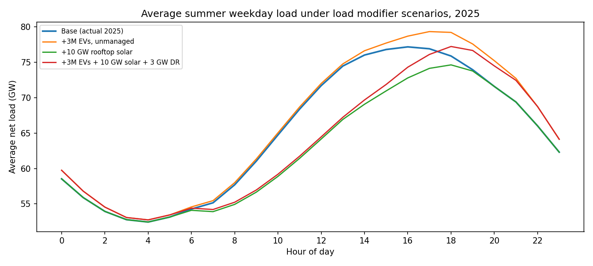
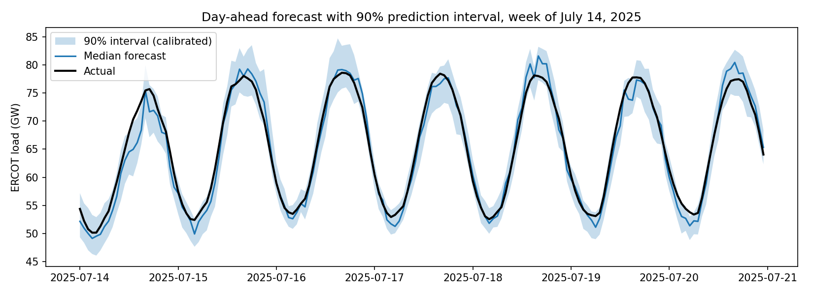

# ERCOT Load Forecasting

Day-ahead hourly load, daily peak, and monthly energy forecasts for the ERCOT
(Texas) grid, built on public ERCOT load archives, NOAA weather observations,
and Texas employment data, with automated data quality checks.

## Results (2025 holdout year)

### Hourly day-ahead load
| Forecast | MAPE | Bias | Peak-day MAPE |
|---|---|---|---|
| Seasonal naive (same hour last week) | 8.65% | +0.49% | 9.36% |
| Linear regression (weather + calendar) | 5.42% | +0.76% | 6.36% |
| **XGBoost** | **2.94%** | **+0.45%** | **3.32%** |

XGBoost reduces error by about 46% versus the weather regression.


### Daily peak demand (day-ahead)
| Forecast | MAPE | Top 10% peak days MAPE |
|---|---|---|
| Seasonal naive | 9.36% | 2.83% |
| Linear regression | 3.92% | 3.04% |
| **XGBoost** | **3.53%** | **1.91%** |

### Monthly energy
Weather-normalized regression on heating and cooling degree days, Texas nonfarm
employment, and a linear trend: **3.15% MAPE**, with a consistent -3.15% bias
(see limitations).

### Data quality checks
Five automated checks (missing values, physical range, spikes, flatlines, and
zones vs. system total). All 250 planted anomalies were detected in an injection
test. On the real data, the only flags were 48 hours on May 17–18, 2021, where
the weather zones don't sum to the reported ERCOT total.

### Load modifier scenarios (what-if)
Stylized EV, rooftop solar, and demand response profiles added to actual 2025
load, based on stated assumptions (not measured data):

| Scenario | Annual peak change | Energy change |
|---|---|---|
| +1M EVs, unmanaged (evening) charging | +1.0% | +0.7% |
| +1M EVs, managed (overnight) charging | 0.0% | +0.7% |
| +3M EVs, unmanaged charging | +3.0% | +2.2% |
| +10 GW rooftop solar | -2.0% | -3.1% |
| 3 GW demand response (top 20 days) | -0.7% | -0.1% |

The same EVs add the same energy either way, but overnight charging adds
nothing to the peak. Solar cuts energy more than peak, because
the peak shifts to about 6 PM as solar output fades. The small demand response
effect reflects the script's simple fixed 4-hour window, which lets the peak move
to an adjacent hour.



### Forecast uncertainty
90% prediction intervals from quantile gradient boosting, calibrated on 2024 with
conformalized quantile regression:

| Coverage (target 90%) | Raw | Calibrated |
|---|---|---|
| All hours | 85.2% | **90.5%** |
| Daily peak hours | 80.8% | **88.0%** |
| Top 10% peak days | 73.0% | **83.8%** |

Average calibrated interval width is 7.1 GW. Peak days remain under-covered.



### Interactive dashboard
[Forecast performance dashboard](https://mynk711.github.io/ercot-load-forecasting/figures/dashboard.html):
monthly error and bias, error by hour, error vs temperature, and worst days.

## Data
- **Load:** ERCOT Hourly Load Data Archives, 2019–2025, total and by weather zone.
  Timestamps are hour-ending Central time, converted to hour-beginning.
- **Weather:** Hourly temperatures from NOAA stations (via the Meteostat library)
  for Houston, Dallas–Fort Worth, San Antonio, and Austin, blended into one
  load-weighted temperature. Meteostat fills short station gaps.
- **Economy:** Texas All Employees, Total Nonfarm (FRED series TXNA).
- **Calendar:** Hour, day of week, month, weekends, federal holidays.

## Method
- **Target:** Load as a ratio to the same hour one week earlier. Tree models can't
  extrapolate beyond training values, so predicting raw load caused a -4.6% bias
  given ERCOT's rapid load growth. The ratio target removed it.
- **Features:** Temperature, degree days (base 65°F), 24-hour rolling temperature,
  lagged temperatures, calendar variables, and recent load relative to last week.
- **Forecast horizon:** True day-ahead, using only load from 48+ hours earlier,
  known the morning before. A rolling 24-hour-ahead version scores 2.18% MAPE.
- **Training:** 2019–2024, excluding Winter Storm Uri (Feb 10–20, 2021), when
  recorded load was cut by load shedding and doesn't reflect true demand.
  Excluding it cut the error on the Feb 20, 2025 record winter peak from 11.3%
  to 6.9%.
- **Testing:** All of 2025, never seen in training.

## Limitations
- **Observed weather:** The models use actual temperatures, which assumes a
  perfect weather forecast. Operational error would be higher.
- **Weather coverage:** Four stations stand in for all of Texas, and only
  temperature is used. Humidity and more stations are available in the data
  source but not yet used.
- **Afternoon peak hours** have the highest hourly error (about 3.5%).
- **Winter and mild weekend days** are the largest sources of daily error.
- **Monthly energy** is under-forecast every month: load growth is accelerating
  and is driven by large industrial loads that employment and a linear trend
  don't capture.
- **Single test year:** Results are from 2025 only.


## How to run
1. Download ERCOT yearly load archives (2019–2025) from
   ercot.com/gridinfo/load/load_hist, unzip, and place them in `data/raw/load/`.
2. Download the TXNA CSV from fred.stlouisfed.org/series/TXNA and save it as
   `data/raw/TXNA.csv`.
3. Run:
```bash
python -m venv .venv && source .venv/bin/activate
pip install -r requirements.txt
cd src
python 01_load_ercot.py       # clean load archives
python 02_weather.py          # download weather
python 03_features.py         # build features
python 04_train_evaluate.py   # hourly models
python 05_data_quality.py     # data quality checks
python 06_daily_peak.py       # daily peak models
python 07_monthly_energy.py   # monthly energy model
python 08_load_modifiers.py   # EV, solar, demand response scenarios
python 09_uncertainty.py      # prediction intervals
python 10_dashboard.py        # builds figures/dashboard.html
```
On macOS, XGBoost needs OpenMP: `brew install libomp`.