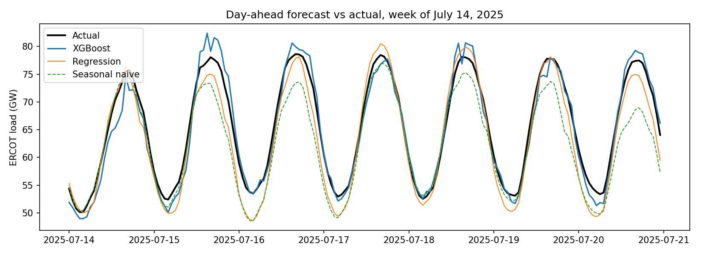
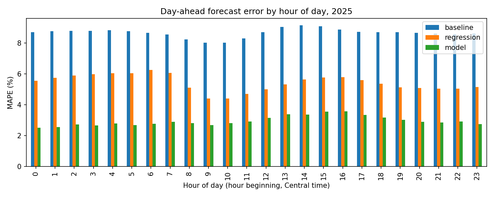

# ERCOT Short-Term Load Forecasting

Hourly forecasting of total ERCOT electricity demand using public ERCOT load
archives, NOAA weather observations, and calendar features. A gradient-boosted
model is benchmarked against a seasonal naive baseline on 2025 data.

## Results (2025 test year)

| Forecast | MAPE | Bias | Peak-day MAPE | Hottest 10% of hours MAPE |
|---|---|---|---|---|
| Seasonal naive (same hour last week) | _fill in_ | _fill in_ | _fill in_ | _fill in_ |
| XGBoost | _fill in_ | _fill in_ | _fill in_ | _fill in_ |




## Data
- **Load:** ERCOT Hourly Load Data Archives (ercot.com/gridinfo/load/load_hist),
  2019–2025, by weather zone. Timestamps are *hour ending* in Central time and
  are converted to hour beginning.
- **Weather:** Hourly temperatures from NOAA stations via `meteostat` for
  Houston, Dallas–Fort Worth, San Antonio, and Austin, blended into one
  load-weighted temperature.
- **Calendar:** Hour, day of week, month, weekends, and federal holidays.

## Method
1. **Clean load data:** standardize zone names across years, drop the repeated
   fall daylight-saving hour, fill the skipped spring hour, remove duplicates.
2. **Weather:** convert to Fahrenheit, fill short station gaps, compute a
   load-weighted average temperature.
3. **Features:** temperature, temperature squared, cooling and heating degrees
   (base 65°F), 24-hour rolling temperature, temperature × time of day,
   calendar features, and load lagged 24 and 168 hours.
4. **Model:** XGBoost trained on 2019–2024 and tested on 2025.
5. **Evaluation:** MAPE, bias, peak-day MAPE, and error on the hottest hours,
   compared against a seasonal naive baseline.

## Limitations and next steps
- Uses **observed** temperatures, which assumes a perfect weather forecast.
  Real operational forecasts use weather forecasts, so true error would be higher.
- One blended temperature for all of Texas; per-zone models would capture
  regional weather differences.
- Next: daily peak and monthly energy models, automated data quality checks,
  and prediction intervals for forecast uncertainty.

## How to run
```bash
python -m venv .venv && source .venv/bin/activate
pip install -r requirements.txt
cd src
python 01_load_ercot.py      # clean load archives
python 02_weather.py         # download weather
python 03_features.py        # build features
python 04_train_evaluate.py  # train, evaluate, make figures
```
